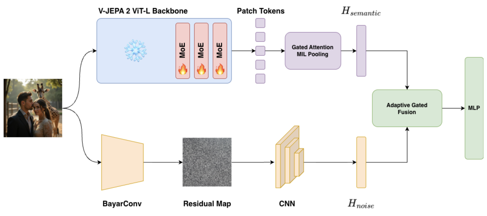
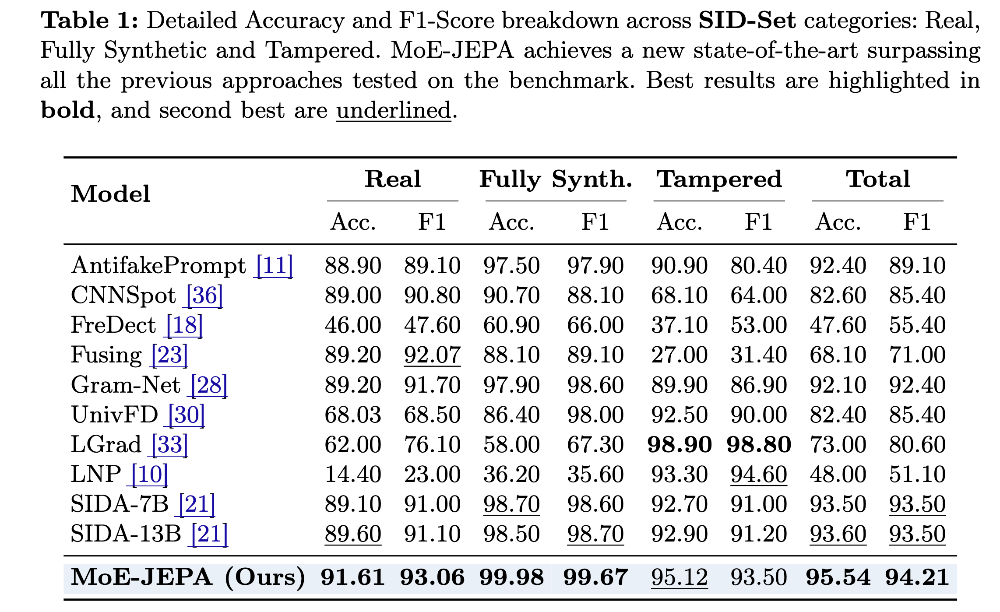

# MoE-JEPA

**Unifying Semantic Priors and High-Frequency Traces: Enhancing V-JEPA with Mixture-of-Experts for Robust Synthetic Image Forensics**

Simone Teglia, Irene Amerini
[ALCOR Lab](https://alcorlab.diag.uniroma1.it/) · Sapienza University of Rome

Accepted at the **2026 Workshop on AI for Multimedia Forensics & Disinformation Detection (AI4MFDD)** @ **ECCV 2026**.

## Architecture

<p align="center">
  
</p>

A dual-branch design, fused adaptively.

**Semantic branch.** A frozen **V-JEPA 2 ViT-L** encoder, kept at the level of *unpooled
patch tokens* so spatial detail survives. A **residual Mixture-of-Experts** module is
injected into the last three transformer blocks: one *frozen shared expert* preserves the
pretrained world knowledge, while **top-2 of 6** trainable routed experts adapt to
forensic cues without catastrophic forgetting. Tokens are aggregated with **Gated
Attention MIL pooling** rather than average pooling, which mutes pristine background
patches and spotlights manipulated ones.

**Noise branch.** The raw image passes through a constrained **BayarConv** layer, forced
to predict each pixel from its neighbours. This suppresses semantic content and exposes
the high-frequency generative and sensor artefacts that survive even a semantically
coherent forgery. A lightweight CNN turns the residual map into a feature vector.

**Adaptive gated fusion.** A learned gate `α`, computed per image, sets how much the noise
stream contributes relative to the semantic one:

```
H_fused = H_semantic + α · H_noise
```

The fused representation goes to an MLP head for the three-way Real / Fully-Synthetic /
Tampered decision.

## Repository structure

```
MoE-JEPA/
├── README.md
├── requirements.txt
├── predict.py          # classify single images with the released checkpoint
├── model/
│   └── model.py        # all architecture components:
│                       #   - frozen V-JEPA 2 ViT-L backbone
│                       #   - residual MoE block (shared + top-2-of-6 routed)
│                       #   - Gated Attention MIL pooling
│                       #   - BayarConv noise branch + CNN
│                       #   - adaptive gated fusion + classifier head
│                       #   - load_moejepa() / preprocess_image() helpers
├── train/
│   ├── train.py        # training on SID-Set
│   └── test.py         # evaluation on SID-Set / RRDataset
└── scripts/
    └── export_checkpoint.py  # Lightning .ckpt -> release .safetensors
```

## Installation

```bash
git clone https://github.com/ALCOR-Lab-DIAG/MoE-JEPA.git
cd MoE-JEPA
conda create -n moejepa python=3.12 -y
conda activate moejepa
pip install -r requirements.txt
```

Tested with Python 3.14, PyTorch 2.11, transformers 5.3 and Lightning 2.6 on a single GPU.

The frozen V-JEPA 2 ViT-L backbone
([`facebook/vjepa2-vitl-fpc64-256`](https://huggingface.co/facebook/vjepa2-vitl-fpc64-256))
is downloaded automatically from the Hugging Face Hub on first use. Pass `--model_name`
to point the scripts at a local copy instead.

## Pretrained checkpoint

The SID-Set checkpoint is attached to the
[v1.0 release](https://github.com/ALCOR-Lab-DIAG/MoE-JEPA/releases/tag/v1.0):

```bash
wget https://github.com/ALCOR-Lab-DIAG/MoE-JEPA/releases/download/v1.0/moejepa_sidset.safetensors
```

| File | Size | SHA-256 |
|---|---|---|
| `moejepa_sidset.safetensors` | 618 MB | `7987fbf785e325dc6f511134989abc3d88f79e31cf609c3ef9099f8e426ecfb9` |

It holds only the weights trained on SID-Set (MoE routers and routed experts, MIL pooler,
noise branch, fusion gate, classifier) together with the hyperparameters. The frozen
backbone and shared experts are rebuilt from the V-JEPA 2 weights at load time.

## Usage

**Inference on your own images.** Labels are `real`, `fake` (fully synthetic) and `tampered`.

```bash
python predict.py --checkpoint moejepa_sidset.safetensors path/to/image.jpg
```

From Python:

```python
from PIL import Image
from model.model import load_moejepa, load_processor, preprocess_image, LABELS

model = load_moejepa("moejepa_sidset.safetensors", device="cuda")
processor = load_processor()

x = preprocess_image(Image.open("image.jpg"), processor).unsqueeze(0).to("cuda")
probs = model(x).softmax(dim=-1)[0]
print(LABELS[probs.argmax()], probs.tolist())
```

V-JEPA 2 is a video encoder, so `preprocess_image` repeats each image into a static
4-frame clip, the same input format used during training.

**Evaluation.** `--dataset` is either a dataset saved with `save_to_disk()` or a Hugging
Face Hub id; labels must follow SID-Set (0 = real, 1 = fully synthetic, 2 = tampered).

```bash
python train/test.py --checkpoint moejepa_sidset.safetensors --dataset /path/to/sidset_test --split test
```

**Training.** `train/train.py` downloads [SID-Set](https://huggingface.co/datasets/saberzl/SID_Set)
and trains with the configuration from the paper. Set `name_run` inside the script first.
Checkpoints are written to `checkpoints/<name_run>/` and can be exported to the release
format with:

```bash
python scripts/export_checkpoint.py --ckpt checkpoints/<name_run>/best-epoch=XX.ckpt --out moejepa.safetensors
```

## Data

| Dataset | Used for | Reference |
|---|---|---|
| **SID-Set** | Training and in-domain evaluation. 300K images, evenly split across Real / Fully-Synthetic / Tampered, sourced from social media so it already carries realistic compression. Split 210K train · 30K val · 60K test. | Huang et al., *SIDA: Social Media Image Deepfake Detection, Localization and Explanation with Large Multimodal Model*, CVPR 2025 |
| **RRDataset** | Robustness under real-world degradation: Original → Transmission → Re-Digitalization (screen recapture), over sensitive domains including war and disaster imagery. | Li et al., *Bridging the Gap Between Ideal and Real-World Evaluation*, ICCV 2025 |

## Results

<p align="center">
  
</p>

### SID-Set

| | Accuracy | F1 |
|---|---|---|
| **MoE-JEPA** | **95.54%** | **94.21%** |

State of the art on SID-Set with **379M active parameters** — outperforming SIDA-13B,
a model more than 30× larger. Performance is balanced across all three classes, where
per-class specialists tend to mode-collapse: LGrad scores higher on Tampered (98.90 vs.
95.12) but falls to 62% on Real and 58% on Fake, which makes it unusable in the wild.

### RRDataset

**84.11%** overall — second overall, and **first against every zero-shot vision-language
model tested**, including GPT-4o, Claude-3.7, Gemini-2 and Grok-2. Strongest on the
hardest split, Re-Digitalization (Real), where physical recapture destroys most
pixel-level cues.

*Known limitation:* Fake-recall degrades under aggressive re-digitalization. This is the
clearest direction for future work on the noise branch.

### Ablation (SID-Set, overall accuracy)

| Configuration | Accuracy |
|---|---|
| Frozen V-JEPA baseline (average pooling) | 80.3% |
| + Noise stream | 84.9% |
| + MoE | 95.1% |
| + MoE + Gated Attention MIL | 95.5% |
| **Full model** | **95.54%** |

The Mixture-of-Experts contributes the largest single jump. The noise branch is what
recovers Tampered-class detection in the full model.

## Citation

Coming Soon 🚀 

<!-- ```bibtex
@inproceedings{teglia2026moejepa,
  title     = {Unifying Semantic Priors and High-Frequency Traces: Enhancing V-JEPA
               with Mixture-of-Experts for Robust Synthetic Image Forensics},
  author    = {Teglia, Simone and Amerini, Irene},
  booktitle = {Proceedings of the Workshop on AI for Multimedia Forensics and
               Disinformation Detection (AI4MFDD), ECCV},
  year      = {2026}
}
``` -->

## Contact

Simone Teglia — teglia@diag.uniroma1.it
